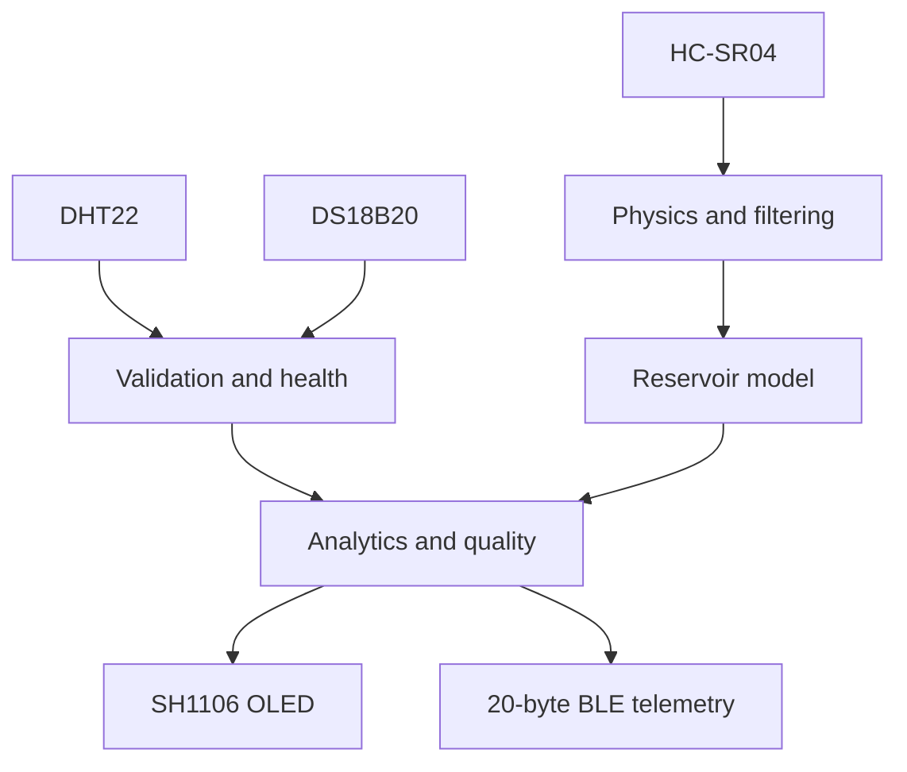

<!--
SPDX-FileCopyrightText: 2026 Rupam Mondal
SPDX-License-Identifier: MIT
-->

<div align="center">

# HydroSense ESP32-C3 Sensor Node

### Environmental sensing, reservoir analytics, OLED monitoring and BLE telemetry


</div>

---

## Overview

HydroSense ESP32-C3 is the sensing and edge-processing node of the larger HydroSense hydroponic monitoring system.

This firmware acquires real measurements from environmental and reservoir sensors, validates the readings, performs physical and statistical processing, evaluates sensor health and data quality, displays information on a local SH1106 OLED, and publishes a compact 20-byte telemetry packet through Bluetooth Low Energy (BLE).

This folder contains only the ESP32-C3 firmware. The complete HydroSense repository will also contain the ESP32-S3 gateway and backend components in separate folders.

The firmware does not intentionally generate substitute sensor readings when hardware data is unavailable. Invalid readings are rejected, health states are updated, and unavailable values are represented explicitly.

## Author and copyright

```text
Sole author: Rupam Mondal
Copyright: Copyright (c) 2026 Rupam Mondal
Software license: MIT License
```

Rupam Mondal is the sole author and copyright holder of the original HydroSense ESP32-C3 source code.

Third-party frameworks and libraries remain the property of their respective copyright holders and continue to use their original licenses.

## Main capabilities

- DHT22 air-temperature and relative-humidity acquisition
- DS18B20 water-temperature acquisition
- Asynchronous 12-bit DS18B20 conversion
- OneWire device discovery and ROM-address validation
- HC-SR04 ultrasonic distance measurement
- Temperature-dependent speed-of-sound correction
- Genuine-sample rolling filtering
- Trimmed-mean ultrasonic stabilization
- Full, half and empty reservoir calibration
- Rectangular reservoir geometry
- Vertical cylindrical reservoir geometry
- Water-depth, level and volume estimation
- ESP32 non-volatile storage using NVS
- Dew-point calculation
- Dew-point-depression calculation
- Saturation-vapor-pressure calculation
- Actual-vapor-pressure calculation
- Vapor-pressure-deficit calculation
- Absolute-humidity calculation
- Heat-index calculation
- Air-to-water temperature-difference calculation
- Rolling signal statistics and trend estimation
- Sensor freshness and fault classification
- Historical sensor-availability tracking
- Transparent data-quality scoring
- Three-page SH1106 OLED interface
- Physical push-button page switching
- Serial-based reservoir setup and calibration
- Versioned 20-byte BLE telemetry protocol
- CRC-16 protection of BLE telemetry
- Automatic BLE advertising recovery after disconnection

## Processing architecture



The main processing sequence is:

1. Acquire genuine physical sensor measurements.
2. Reject invalid, non-finite or out-of-range measurements.
3. Preserve a last genuine measurement only while the freshness policy permits it.
4. Apply ultrasonic temperature correction.
5. Add valid ultrasonic measurements to the rolling filter.
6. Calculate reservoir depth, level and volume when calibration permits.
7. Calculate environmental quantities.
8. Update signal trends only for genuinely new source timestamps.
9. Evaluate sensor health and data quality.
10. Create an OLED display snapshot.
11. Encode a versioned BLE packet.
12. Calculate and append its CRC-16 value.
13. Notify the connected ESP32-S3 gateway.

## Runtime model and FreeRTOS clarification

The ESP32 Arduino framework runs on top of FreeRTOS internally.

This firmware does not currently create custom FreeRTOS tasks, queues, semaphores, mutexes or event groups.

HydroSense C3 uses a cooperative `millis()`-based scheduler inside the Arduino `loop()` function. Sensor, display, terminal and BLE operations are scheduled around the higher-frequency HC-SR04 acquisition deadline.

## Required hardware

| Quantity | Component | Purpose |
|---:|---|---|
| 1 | ESP32-C3 SuperMini or compatible ESP32-C3 board | Main sensing controller |
| 1 | DHT22 | Air temperature and relative humidity |
| 1 | Waterproof DS18B20 | Water temperature |
| 1 | HC-SR04 | Reservoir surface distance |
| 1 | SH1106 128×64 I²C OLED | Local display |
| 1 | Normally-open push button | OLED page selection |
| 1 | HC-SR04 ECHO voltage divider or logic-level shifter | ESP32-C3 input protection |
| As required | Pull-up resistors | DHT22 and DS18B20 data lines |
| As required | Jumper wires and stable power supply | Interconnection and power |

## Proven pin mapping

| Device | Signal | ESP32-C3 pin |
|---|---|---:|
| DHT22 | DATA | GPIO1 |
| DS18B20 | DATA | GPIO2 |
| Push button | Input, active LOW | GPIO3 |
| HC-SR04 | ECHO through voltage reduction | GPIO5 |
| HC-SR04 | TRIG | GPIO6 |
| SH1106 OLED | SDA | GPIO8 |
| SH1106 OLED | SCL | GPIO9 |
| SH1106 OLED | I²C address | `0x3C` |

The push button is connected between GPIO3 and GND.

The firmware configures the button using `INPUT_PULLUP`, so an additional external button pull-up is normally unnecessary.

## Electrical safety warning

> [!WARNING]
> A conventional HC-SR04 is commonly powered from 5 V and may produce an ECHO signal near 5 V. ESP32-C3 GPIO is a 3.3 V interface. Do not connect a 5 V ECHO output directly to GPIO5.

Use a correctly designed voltage divider or logic-level shifter between the HC-SR04 ECHO output and ESP32-C3 GPIO5.

Also ensure that:

- All connected modules share a common ground.
- The selected OLED module is compatible with the supplied voltage.
- Bare DHT22 and DS18B20 sensors have suitable data-line pull-ups.
- Supply polarity is checked before powering the system.
- The ESP32-C3 is disconnected from power while changing wiring.
- Every module is checked against its manufacturer documentation.

## Software requirements

Install:

1. Visual Studio Code
2. PlatformIO IDE extension
3. A suitable ESP32-C3 USB driver, if required
4. Git, if cloning the repository through Git

The included `.vscode/extensions.json` file allows Visual Studio Code to recommend PlatformIO automatically.

## Quick start

### 1. Obtain the repository

Download the repository ZIP from GitHub and extract it.

Alternatively, clone it:

```bash
git clone <YOUR-GITHUB-REPOSITORY-URL>
```

### 2. Open the C3 folder

Open this exact folder in Visual Studio Code:

```text
HydroSense_C3
```

The opened folder must directly contain:

```text
platformio.ini
```

Do not open only the `src` directory.

### 3. Wait for PlatformIO

During the first build, PlatformIO downloads:

- Espressif32 platform
- Arduino-ESP32 framework
- Declared sensor libraries
- Declared display libraries
- Compiler and upload tools

The generated `.pio` directory contains local build files and must not be uploaded to GitHub.

### 4. Connect the board

Connect the ESP32-C3 using a USB data cable.

A power-only USB cable cannot upload firmware.

### 5. Build the firmware

Use the PlatformIO **Build** button or run:

```bash
pio run
```

### 6. Upload the firmware

Use the PlatformIO **Upload** button or run:

```bash
pio run --target upload
```

### 7. Open Serial Monitor

Use the PlatformIO **Serial Monitor** button or run:

```bash
pio device monitor
```

The configured baud rate is:

```text
115200 baud
```

Press `Ctrl+C` to close the terminal Serial Monitor.

## Clean rebuild

If a local build becomes inconsistent, run:

```bash
pio run --target clean
pio run
```

The generated `.pio` directory may also be deleted manually. PlatformIO recreates it during the next build.

Deleting `.pio` does not delete the HydroSense source code or calibration stored on the ESP32-C3.

## PlatformIO environment

The project uses:

```ini
[env:esp32-c3-devkitm-1]

platform = espressif32@6.12.0
board = esp32-c3-devkitm-1
framework = arduino

monitor_speed = 115200
upload_speed = 921600

build_flags =
    -DARDUINO_USB_MODE=1
    -DARDUINO_USB_CDC_ON_BOOT=1
```

The physical project uses an ESP32-C3 SuperMini. The compatible PlatformIO board definition is `esp32-c3-devkitm-1`.

## Pinned dependencies

| Dependency | Version | Purpose |
|---|---:|---|
| Adafruit DHT sensor library | 1.4.7 | DHT22 acquisition |
| Adafruit Unified Sensor | 1.1.15 | Adafruit sensor abstraction |
| OneWire | 2.3.8 | DS18B20 OneWire communication |
| DallasTemperature | 4.0.6 | DS18B20 temperature interface |
| Adafruit GFX Library | 1.12.6 | OLED graphics primitives |
| Adafruit SH110X | 2.1.15 | SH1106 OLED driver |

PlatformIO downloads these dependencies automatically. Do not manually copy them into `src`, `include` or `lib`.

## Sensor scheduling

| Operation | Nominal interval | Implementation |
|---|---:|---|
| HC-SR04 acquisition | 250 ms | Highest-frequency physical deadline |
| DHT22 acquisition | 2,000 ms | Begins after non-blocking startup warm-up |
| DS18B20 conversion request | 2,000 ms | Asynchronous 12-bit conversion |
| Analytics and BLE publication | 3,000 ms | Scheduled after sensor processing |
| Button debounce | 35 ms | Software edge detection |
| OLED minimum frame interval | 75 ms | Duplicate visible-frame suppression |

The approximately 750 ms DS18B20 conversion does not block the main loop.

The HC-SR04 `pulseIn()` operation uses a bounded timeout.

## Sensor validation

### DHT22

| Measurement | Accepted range |
|---|---:|
| Air temperature | −40 °C to 80 °C |
| Relative humidity | 0% to 100% |

Non-finite and out-of-range readings are rejected.

### DS18B20

Accepted physical range:

```text
−55 °C to 125 °C
```

The firmware also rejects:

- DallasTemperature disconnected-device value
- Non-finite readings
- DS18B20 85 °C startup/default value

HydroSense expects one DS18B20-family water-temperature probe. The driver identifies it using its 64-bit OneWire ROM address.

### HC-SR04

Accepted distance range:

```text
2 cm to 400 cm
```

A zero-length echo, timeout or out-of-range echo is rejected.

## Ultrasonic processing

The initial HC-SR04 distance is calculated using:

```text
distance = echo duration × nominal speed of sound ÷ 2
```

When valid air temperature is available, the speed of sound is approximated using:

```text
c = 331.3 + 0.606T
```

Where:

- `c` is the speed of sound in metres per second.
- `T` is air temperature in degrees Celsius.
- Division by two accounts for the outgoing and returning ultrasonic path.

### Rolling filter

```text
Filter window: 7 genuine measurements
Minimum usable samples: 5
Stable-distance deadband: 0.10 cm
```

Only genuine, finite sensor measurements enter the filter.

When at least three samples are available, the trimmed-mean calculation:

1. Sorts the active samples.
2. Removes one minimum value.
3. Removes one maximum value.
4. Averages the remaining values.

Missed echoes are not inserted as zeroes or fabricated measurements.

## Sensor-health policy

| Sensor | LIVE timeout | FAULT timeout |
|---|---:|---:|
| DHT22 | 5,000 ms | 15,000 ms |
| DS18B20 | 5,000 ms | 15,000 ms |
| HC-SR04 | 1,500 ms | 5,000 ms |

Possible health states:

| State | Meaning |
|---|---|
| `NEVER` | No valid physical measurement has been obtained |
| `LIVE` | A genuine valid measurement remains fresh |
| `STALE` | A previous valid measurement exists but is aging |
| `FAULT` | The sensor has remained unavailable beyond its fault timeout |

A single failed acquisition does not automatically erase a still-fresh genuine measurement.

## Reservoir configuration

HydroSense supports two straight-sided reservoir shapes:

1. Rectangular tank
2. Vertical cylinder or drum

All dimensions entered through the Serial Monitor are in centimetres.

### Rectangular reservoir

Required dimensions:

- Internal length
- Internal width
- Internal height

Capacity:

```text
capacity = length × width × height ÷ 1000
```

### Vertical cylindrical reservoir

Required dimensions:

- Internal diameter
- Internal height

Capacity:

```text
capacity = π × radius² × height ÷ 1000
```

Division by 1,000 converts cubic centimetres to litres.

## Reservoir calibration

The ultrasonic sensor is assumed to be mounted above the water surface.

Therefore:

```text
FULL distance < HALF distance < EMPTY distance
```

- `FULL` is the shortest sensor-to-water distance.
- `HALF` is the optional 50% calibration point.
- `EMPTY` is the longest sensor-to-bottom or lowest-level distance.

When a valid HALF point exists, the firmware uses piecewise interpolation:

- FULL to HALF maps from 100% to 50%.
- HALF to EMPTY maps from 50% to 0%.

If HALF has not been recorded, the firmware uses linear interpolation between FULL and EMPTY.

## Serial Monitor commands

Open PlatformIO Serial Monitor at 115200 baud.

| Command | Action |
|---|---|
| `R` | Configure reservoir type and dimensions |
| `F` | Save current stable distance as FULL or 100% |
| `H` | Save current stable distance as HALF or 50% |
| `E` | Save current stable distance as EMPTY or 0% |
| `STATUS` | Show reservoir status and resume periodic terminal output |
| `S` | Short form of `STATUS` |
| `PAUSE` | Pause periodic terminal presentation |
| `C` | Clear saved geometry and F/H/E calibration |
| `?` | Display terminal help |
| `X` | Cancel active reservoir-geometry setup |

Press Enter after each command.

### Recommended calibration sequence

1. Enter `R`.
2. Select `1` for a rectangular tank or `2` for a vertical cylinder.
3. Enter the requested internal dimensions.
4. Set the water surface to the intended full position.
5. Wait for a stable distance.
6. Enter `F`.
7. Set the water surface to the physical half position.
8. Wait for a stable distance.
9. Enter `H`.
10. Set the water surface to the intended empty position.
11. Wait for a stable distance.
12. Enter `E`.
13. Enter `STATUS`.

The accepted configuration is stored in ESP32 NVS and survives restart or power loss.

> [!CAUTION]
> The `C` command clears the stored reservoir geometry and calibration.

## OLED interface

The runtime OLED interface contains exactly three pages:

| Page | Header | Information |
|---:|---|---|
| 1 | `SENS` | Air temperature, humidity, water temperature, distance, level and quality |
| 2 | `TANK` | Reservoir type, capacity, calibration points, current level and volume |
| 3 | `DERIV` | Dew point, VPD, absolute humidity, air-water difference and speed of sound |

Pressing the GPIO3 button advances to the next page.

After page 3, the display returns to page 1.

The OLED controller compares only values visible on the active page at their rendered precision. An unchanged visible frame is not unnecessarily retransmitted over I²C.

## BLE interface

### Device and service

| Item | Value |
|---|---|
| BLE device name | `HydroSense_C3` |
| Service UUID | `7b2c1000-6e9f-4b5a-9f8e-4a7c33b10001` |
| Telemetry characteristic UUID | `7b2c1001-6e9f-4b5a-9f8e-4a7c33b10001` |
| Characteristic properties | Read and Notify |
| Protocol version | 1 |
| Packet size | 20 bytes |
| Magic value | `0x4853` |

The ESP32-C3 restarts BLE advertising after the ESP32-S3 gateway disconnects. Restart work is deferred out of the BLE callback.

### Security scope

The BLE characteristic transports sensor telemetry.

The current firmware does not implement application-level encryption, a passkey or an authenticated command channel.

Do not transmit passwords, private keys or other secrets through this telemetry packet.

## BLE packet layout

The ESP32-C3 is little-endian, and the packet structure is packed to exactly 20 bytes.

| Offset | Size | Type | Field | Encoding |
|---:|---:|---|---|---|
| 0 | 2 | `uint16_t` | `magic` | `0x4853` |
| 2 | 1 | `uint8_t` | `version` | Protocol version |
| 3 | 1 | `uint8_t` | `sequence` | Wraparound packet counter |
| 4 | 2 | `int16_t` | `airTemperature_cC` | °C × 100 |
| 6 | 2 | `uint16_t` | `humidity_cPct` | %RH × 100 |
| 8 | 2 | `int16_t` | `waterTemperature_cC` | °C × 100 |
| 10 | 2 | `uint16_t` | `stableDistance_mm` | Distance in millimetres |
| 12 | 2 | `uint16_t` | `waterLevel_cPct` | Percentage × 100 |
| 14 | 1 | `uint8_t` | `qualityPct` | Integer percentage from 0–100 |
| 15 | 2 | `uint16_t` | `qualityFlags` | Data-quality bit mask |
| 17 | 1 | `uint8_t` | `validMask` | Sensor and calibration validity |
| 18 | 2 | `uint16_t` | `crc16` | CRC over bytes 0–17 |

The source contains a compile-time assertion:

```cpp
static_assert(sizeof(C3BlePacket) == 20,
              "C3BlePacket must be exactly 20 bytes");
```

### Invalid-value sentinels

| Field type | Invalid sentinel |
|---|---:|
| Signed 16-bit encoded value | `INT16_MIN`, or −32768 |
| Unsigned 16-bit encoded value | `UINT16_MAX`, or 65535 |
| Quality score | 0, interpreted with validity and quality flags |

Consumers must check `validMask` and `qualityFlags` instead of trusting a numeric field alone.

### Validity mask

| Bit | Hex | Meaning |
|---:|---:|---|
| 0 | `0x01` | DHT22 data valid |
| 1 | `0x02` | DS18B20 data valid |
| 2 | `0x04` | Ultrasonic data valid |
| 3 | `0x08` | Reservoir result valid |
| 4 | `0x10` | Reservoir calibration valid |

### Quality flags

| Bit | Hex | Meaning |
|---:|---:|---|
| 0 | `0x0001` | DHT22 invalid |
| 1 | `0x0002` | DS18B20 invalid |
| 2 | `0x0004` | Ultrasonic invalid |
| 3 | `0x0008` | Calibration invalid |
| 4 | `0x0010` | Reservoir result invalid |
| 5 | `0x0020` | Environmental result invalid |
| 6 | `0x0040` | Air-temperature trend not ready |
| 7 | `0x0080` | Humidity trend not ready |
| 8 | `0x0100` | Water-temperature trend not ready |
| 9 | `0x0200` | Water-level trend not ready |
| 10 | `0x0400` | VPD trend not ready |

### CRC-16

```text
Polynomial: 0x1021
Initial value: 0xFFFF
Reflected input: No
Reflected output: No
Final XOR: 0x0000
Covered bytes: 0 through 17
```

This corresponds to CRC-16/CCITT-FALSE.

The receiver must calculate CRC over the first 18 bytes and compare it with the `crc16` field before accepting the packet.

## Data-quality score

The data-quality score has a maximum of 100 points.

### Sensor contribution

| Component | Maximum contribution |
|---|---:|
| DHT22 | 20 points |
| DS18B20 | 20 points |
| HC-SR04 | 20 points |

### Processing contribution

| Component | Maximum contribution |
|---|---:|
| Reservoir calibration | 10 points |
| Reservoir result | 10 points |
| Environmental result | 10 points |
| Trend readiness | 10 points |

### Quality states

| Score | State |
|---:|---|
| 85–100 | `GOOD` |
| 50–less than 85 | `DEGRADED` |
| Less than 50 | `INVALID` |

These thresholds are HydroSense engineering-policy values. They are not medical, safety, regulatory or laboratory certifications.

## C3 folder structure

```text
HydroSense_C3/
├── .vscode/
│   ├── c_cpp_properties.json
│   ├── extensions.json
│   └── launch.json
├── include/
│   ├── analytics/
│   ├── config/
│   ├── diagnostics/
│   ├── filters/
│   ├── input/
│   ├── models/
│   ├── physics/
│   ├── reservoir/
│   ├── sensors/
│   ├── ui/
│   ├── README
│   └── pins.h
├── lib/
│   └── README
├── src/
│   ├── analytics/
│   ├── diagnostics/
│   ├── filters/
│   ├── input/
│   ├── physics/
│   ├── reservoir/
│   ├── sensors/
│   ├── ui/
│   └── main.cpp
├── test/
│   └── README
├── platformio.ini
├── README.md
└── THIRD_PARTY_NOTICES.md
```

The generated `.pio` folder may exist locally but must not be committed to GitHub.

Repository-wide files such as `LICENSE`, `CONTRIBUTING.md`, `SECURITY.md`, `CITATION.cff` and `.github` are stored in the parent repository folder.

## Module responsibilities

| Module | Responsibility |
|---|---|
| `sensors` | Genuine physical sensor acquisition |
| `physics` | Environmental and ultrasonic physical calculations |
| `filters` | Rolling robust numerical filtering |
| `reservoir` | Calibration, geometry and NVS persistence |
| `analytics` | Current processed values and time-series trends |
| `diagnostics` | Sensor health and data-quality evaluation |
| `models` | Shared data structures |
| `input` | Debounced physical-button processing |
| `ui` | SH1106 OLED management and page presentation |
| `main.cpp` | Scheduling, BLE, terminal and runtime orchestration |

## Important design rules

- Missed echoes are not converted into fabricated zero-distance samples.
- Invalid environmental readings do not enter trends as genuine measurements.
- Retained last-good measurements are not repeatedly added as new trend samples.
- DS18B20 conversion is asynchronous.
- BLE callbacks remain short.
- BLE reconnection work is deferred to the main scheduler.
- Serial presentation does not intentionally stop sensing or BLE telemetry.
- OLED refresh does not intentionally start immediately before a sonar deadline.
- The 20-byte BLE packet contract must remain compatible with the S3 receiver.
- Calibration and reservoir geometry are stored in NVS.
- Invalid data is represented through validity states, sentinels and quality flags.

## Known limitations

- This folder contains only the ESP32-C3 component.
- The ESP32-S3 gateway and backend are required for the complete end-to-end system.
- No application-level BLE authentication or encryption is implemented.
- HC-SR04 readings are affected by mounting, surface angle, condensation, foam and acoustic reflections.
- Speed-of-sound correction uses a dry-air temperature approximation.
- Humidity is not included in the ultrasonic sound-speed correction.
- Only straight-sided rectangular and cylindrical reservoirs are supported.
- Irregular reservoir geometry is not currently modelled.
- Runtime scheduling is cooperative instead of using application-created FreeRTOS tasks.
- Hardware validation is required after wiring, library, board or timing changes.
- This project is not a certified industrial, safety or laboratory measurement system.

## Troubleshooting

### PlatformIO cannot find the project

Open the `HydroSense_C3` folder containing `platformio.ini`.

Do not open only `src` or the parent repository folder as the PlatformIO project.

### No serial output

Check:

- A USB data cable is connected.
- The correct serial port is selected.
- Serial Monitor is set to 115200 baud.
- Native USB CDC build flags remain enabled.
- Another application is not using the serial port.

### Upload fails at 921600 baud

Close Serial Monitor and try again.

If the connection remains unreliable, temporarily change:

```ini
upload_speed = 921600
```

to:

```ini
upload_speed = 460800
```

This changes upload speed only.

### OLED is not detected

Check:

- SDA is connected to GPIO8.
- SCL is connected to GPIO9.
- I²C address is `0x3C`.
- Ground and supply are connected.
- The display is SH1106-compatible.

### Button does not change the page

Check:

- The button connects GPIO3 to GND.
- The button is normally open.
- The input uses the internal pull-up.
- The switch is not permanently shorted.
- The OLED initialized successfully.

### DS18B20 is not detected

Check:

- DATA is connected to GPIO2.
- A suitable OneWire pull-up is installed.
- Ground and supply are common.
- Exactly one valid DS18B20-family probe is connected.
- Probe wire colours match its supplier documentation.

### HC-SR04 always reports invalid data

Check:

- TRIG is connected to GPIO6.
- ECHO reaches GPIO5 through safe voltage reduction.
- All grounds are common.
- The target is between approximately 2 cm and 400 cm.
- The water surface is sufficiently flat.
- The sensor is not obstructed or affected by condensation.

### Calibration is invalid

For two-point calibration, confirm:

```text
FULL distance < EMPTY distance
```

For three-point calibration, confirm:

```text
FULL distance < HALF distance < EMPTY distance
```

## Development verification checklist

Before accepting a firmware change:

- [ ] Build the complete PlatformIO project.
- [ ] Check compiler errors and warnings.
- [ ] Upload the firmware to the ESP32-C3.
- [ ] Verify DHT22 readings.
- [ ] Verify DS18B20 discovery and conversion.
- [ ] Verify HC-SR04 readings.
- [ ] Verify all three OLED pages.
- [ ] Verify the GPIO3 button.
- [ ] Verify NVS calibration persistence after restart.
- [ ] Verify BLE connection and reconnection.
- [ ] Verify the packet remains exactly 20 bytes.
- [ ] Verify CRC rejection on the receiver.
- [ ] Verify sensor-disconnection behaviour.
- [ ] Verify recovery after reconnecting each sensor.

## Contributing

Repository-wide contribution instructions are provided in [`CONTRIBUTING.md`](../CONTRIBUTING.md).

Submitting a contribution does not remove the original author’s copyright. Contributors must have the right to submit their work and agree to license accepted contributions under the repository’s MIT License.

## Security

Security-reporting instructions are provided in [`SECURITY.md`](../SECURITY.md).

Do not publicly disclose a suspected security vulnerability before the maintainer has had a reasonable opportunity to investigate it.

## Third-party software

C3 dependency and license information is documented in [`THIRD_PARTY_NOTICES.md`](THIRD_PARTY_NOTICES.md).

Downloaded third-party libraries must not be represented as original HydroSense source code.

## Citation

Repository citation metadata is provided in [`CITATION.cff`](../CITATION.cff).

A DOI badge may be added after a numbered release is archived using a research-software repository such as Zenodo.

## License

The original HydroSense software is licensed under the MIT License.

See the repository-level [`LICENSE`](../LICENSE) file.

```text
Copyright (c) 2026 Rupam Mondal
```

Third-party components remain under their respective licenses.

Hardware-design source files are not included in this C3 firmware folder. Future schematic, PCB, mechanical or manufacturing files should receive a separately identified hardware license after review.

## Disclaimer

HydroSense is an engineering and research project.

It is provided without warranty under the terms of the MIT License. Users are responsible for validating electrical safety, sensor accuracy, calibration, environmental suitability and regulatory requirements before deployment.

Do not rely on this project as the sole protection mechanism for equipment, crops, water systems, electrical systems or human safety.