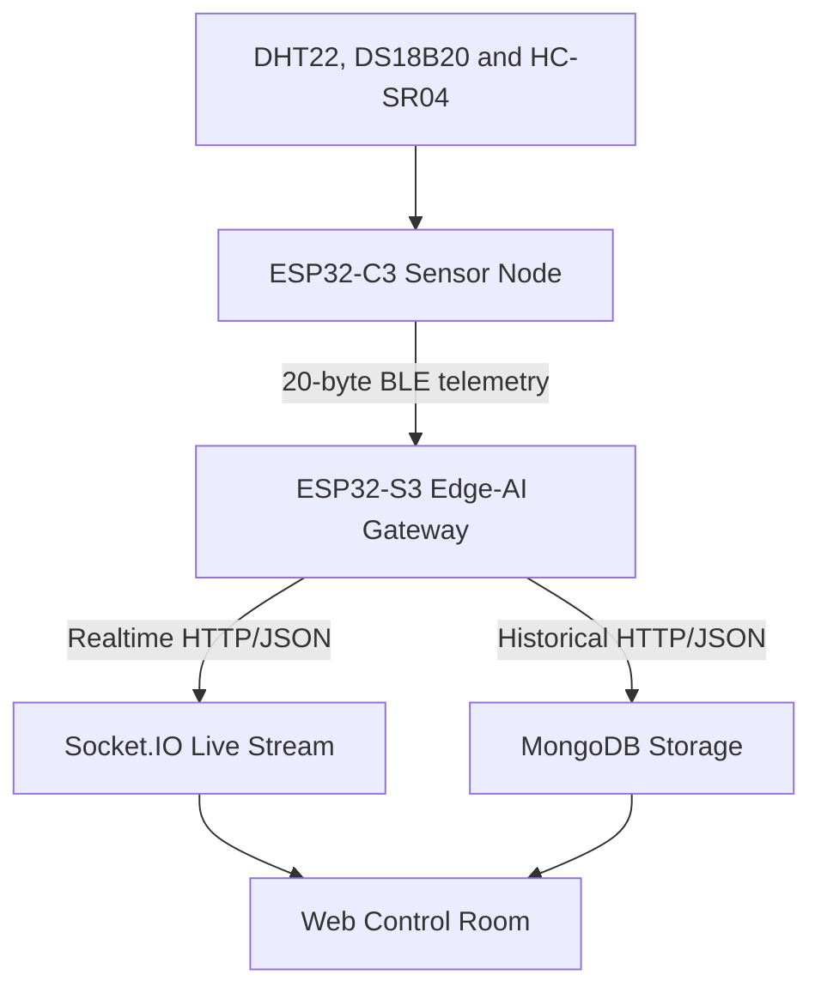

# HydroSense: Trust-Aware Dual-ESP32 Edge-AI Water Monitoring Platform

<div align="center">

[](https://github.com/Rupam-26/HydroSense/actions/workflows/firmware-ci.yml)
[](https://github.com/Rupam-26/HydroSense/actions/workflows/backend-ci.yml)
[](LICENSE)
[](https://github.com/Rupam-26/HydroSense/commits/main)


</div>

HydroSense is a modular IoT and Edge-AI platform for intelligent water and reservoir monitoring.

The system combines an ESP32-C3 sensor node, an ESP32-S3 edge-intelligence gateway, and a Node.js backend with MongoDB storage, realtime Socket.IO communication, machine-learning services, and a browser-based Control Room.

HydroSense collects environmental and reservoir measurements, validates sensor data, transfers protected telemetry over Bluetooth Low Energy, estimates Total Dissolved Solids using an FP32 TinyML soft sensor, evaluates sensor trust, displays live information, stores historical telemetry, and provides realtime remote monitoring.

> **Important:** Estimated TDS is generated by a machine-learning soft sensor. It is not a direct physical TDS measurement.

## System Architecture



## System Components

### ESP32-C3 Sensor Node

The ESP32-C3 is responsible for:

- DHT22 air-temperature and humidity acquisition
- DS18B20 water-temperature acquisition
- HC-SR04 reservoir-distance measurement
- Temperature-corrected ultrasonic processing
- Rolling filtering and calibration
- Water-level and reservoir-volume estimation
- Environmental analytics
- Sensor-health evaluation
- Data-quality scoring
- SH1106 OLED visualization
- Versioned 20-byte BLE telemetry
- CRC-16 packet protection

Project directory:

```text
HydroSense_C3
```

### ESP32-S3 Edge-AI Gateway

The ESP32-S3 is responsible for:

- BLE discovery and connection
- BLE packet validation
- Duplicate and out-of-order packet rejection
- Sensor snapshot construction
- Derived environmental features
- FP32 TinyML TDS estimation
- Sensor-anomaly analysis
- Cross-layer sensor-trust evaluation
- Three-page LCD visualization
- Wi-Fi communication
- Realtime backend delivery
- Historical MongoDB delivery
- BLE and cloud recovery

Project directory:

```text
HydroSense_S3
```

### HydroSense Backend

The backend provides:

- Express REST API
- Realtime Socket.IO telemetry
- MongoDB historical storage
- Device-state monitoring
- Sensor Trust event history
- ML baseline and experiment services
- Model-control services
- Browser-based Control Room
- Telemetry validation
- Centralized error handling

Project directory:

```text
HydroSense_Backend
```

## FP32 TinyML Soft Sensor

The active ESP32-S3 model is a direct FP32 neural-network implementation compiled into the firmware.

| Property | Value |
|---|---|
| Architecture | `3 → 32 → 16 → 8 → 1` |
| Hidden activation | ReLU |
| Output activation | Linear |
| Parameter count | 801 |
| Active format | FP32 weights compiled into firmware |
| Output | Estimated TDS in ppm |

The required input order is:

1. Air temperature
2. Relative humidity
3. Water temperature

The historical INT8 model header is retained for provenance and reproducibility only. It is not used by the active firmware.

Detailed model information is available in:

```text
HydroSense_S3/MODEL_PROVENANCE.txt
```

## Data Flow

1. The ESP32-C3 reads the physical sensors.
2. Invalid or unavailable measurements are identified.
3. Environmental and reservoir values are calculated.
4. A versioned 20-byte telemetry packet is created.
5. CRC-16 is added for packet-integrity checking.
6. The packet is transmitted to the ESP32-S3 through BLE.
7. The ESP32-S3 validates the packet.
8. Derived features and Estimated TDS are calculated.
9. Sensor anomaly and trust results are generated.
10. Current information is displayed on the S3 LCD.
11. Realtime telemetry is sent to the live backend endpoint.
12. Historical telemetry is sent to the MongoDB endpoint.
13. The browser Control Room displays the latest system state.

## Repository Structure

```text
HydroSense/
├── .github/
│   ├── ISSUE_TEMPLATE/
│   ├── dependabot.yml
│   ├── pull_request_template.md
│   └── workflows/
│       ├── backend-ci.yml
│       └── firmware-ci.yml
├── HydroSense_C3/
├── HydroSense_S3/
├── HydroSense_Backend/
├── AUTHORS.md
├── CHANGELOG.md
├── CITATION.cff
├── CODE_OF_CONDUCT.md
├── CONTRIBUTING.md
├── LICENSE
├── README.md
├── SECURITY.md
├── SUPPORT.md
└── THIRD_PARTY_NOTICES.md
```

## Firmware Build

Install PlatformIO before building the firmware.

Build the ESP32-C3 project from the repository root:

```powershell
pio run --project-dir HydroSense_C3
```

Create the local ESP32-S3 configuration file:

```powershell
Copy-Item HydroSense_S3\include\config\S3Secrets.example.h HydroSense_S3\include\config\S3Secrets.h
```

Enter the required Wi-Fi and backend configuration in:

```text
HydroSense_S3\include\config\S3Secrets.h
```

Build the ESP32-S3 project:

```powershell
pio run --project-dir HydroSense_S3
```

Private configuration files such as `S3Secrets.h` must not be committed to Git.

## Backend Setup

The backend requires Node.js 20.19.0 or newer.

Open PowerShell in the repository root and run:

```powershell
cd HydroSense_Backend
Copy-Item .env.example .env
npm install
```

Edit `.env` and enter the MongoDB connection string and other required configuration.

Validate the backend:

```powershell
npm run check
npm run audit
```

Start the server:

```powershell
npm start
```

The default local server address is:

```text
http://localhost:5000
```

The main Control Room is available at:

```text
http://localhost:5000/control-room/overview
```

Additional views include:

```text
http://localhost:5000/control-room/trust
http://localhost:5000/control-room/ml
```

## Automated Verification

Two GitHub Actions workflows verify the repository:

### Firmware CI

The firmware workflow builds:

- ESP32-C3 firmware
- ESP32-S3 firmware using a safe example configuration

### Backend CI

The backend workflow verifies:

- Node.js installation
- Backend dependencies
- JavaScript syntax
- Automated tests
- Python ML dependencies
- Dependency audit

Current workflow status is displayed by the badges at the top of this page.

## Security

Do not commit:

- `.env`
- `S3Secrets.h`
- MongoDB credentials
- Wi-Fi passwords
- API keys
- `node_modules`
- PlatformIO `.pio` directories
- Python `__pycache__` directories
- Local runtime-generated files

Security problems should be reported according to [SECURITY.md](SECURITY.md).

## Project Status

HydroSense is a research and engineering prototype.

The repository has validated builds for:

- ESP32-C3 firmware
- ESP32-S3 firmware
- Node.js backend
- Backend automated tests

The project is not certified for drinking-water safety, medical use, industrial process control, or emergency applications.

## Documentation

Detailed documentation is available in the component directories:

- [ESP32-C3 documentation](HydroSense_C3/README.md)
- [ESP32-S3 documentation](HydroSense_S3/README.md)
- [Backend documentation](HydroSense_Backend/README.md)
- [Model provenance](HydroSense_S3/MODEL_PROVENANCE.txt)
- [Security policy](SECURITY.md)
- [Contribution guide](CONTRIBUTING.md)
- [Support information](SUPPORT.md)
- [Third-party notices](THIRD_PARTY_NOTICES.md)

## Author

**Rupam Mondal**

Copyright © 2026 Rupam Mondal.

## License

HydroSense is distributed under the [MIT License](LICENSE).

Third-party components remain subject to their respective licenses. See [THIRD_PARTY_NOTICES.md](THIRD_PARTY_NOTICES.md) and the component-specific notice files for details.